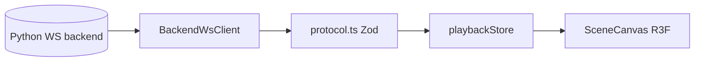

# Architecture

## Layers

```
src/
  app/           AppShell (frame: left pane and the shown section), WorkbenchSection
                 (the workbench views and their state), UI-only Zustand (uiStore)
  components/    Shared UI pieces: Disclosure (+ disclosureStore), PopoverMenu, EmptyState, PageHeader,
                 SectionFrame, LoadingSpinner
  domain/        Simulation protocol, WebSocket client, playback store; cluster/ has the
                 cluster list, the operator API client, the live channel client and stores
  features/      React UI by section: workbench/ (connection, controls, metrics, monitor,
                 scene), cluster/ (with instances/), capabilities/, campaigns/, history/, results/
  language/      Lezer grammar for .problem files
```

## UI conventions

Sizes are tokens in `index.css` (`:root`): body 16px (`--font-size`), captions 13px at the smallest
(`--font-size-xs`), controls and every clickable thing at least 40px (`--control-height`,
`--hit-target`), spacing on a 4px scale (`--space-1` to `--space-6`). Screens use the tokens rather
than their own sizes. One focus ring (`--focus-ring`) covers all keyboard focus.

Each screen shows what its main task needs and hides the rest behind progressive disclosure:
`Disclosure` (a button with `aria-expanded`, optionally remembered per browser through its `id`, kept
open with `forceOpen` while it holds an error), `PopoverMenu` for small groups of options laid over a
canvas, and native `details` (given the same chevron and row size globally) in the monitor panels.
A screen has one primary action (`primary-btn accent`), shown in its `PageHeader` or at the top of its
control panel.

## Sections

The left pane has six sections: Workbench (with the views Domain Configuration, Scene
Generation, Trajectory Generation, Simulation and Connections), Cluster, Capabilities, Campaigns,
Campaign History (section id `history`) and Results. `uiStore` keeps `section` and `workbenchView` (persisted, v6). Other sections
open an output on a workbench page through `openInWorkbench(target)` in
`features/workbench/pages/workbenchTarget.ts`, which shows the page and queues the target for it
(`takeTarget(page)`). The workbench stays mounted while another section is shown, so its gateway socket and state carry on.

The workbench pages (design doc 6.6, `features/workbench/pages/`): Scene Generation, Trajectory
Generation and Simulation each hold `{input, loaded}` in a persisted page store (`pageStore.ts`): the
input (from the previous page's output, a Campaign History output or a file, `PageInputPanel`) and
the target of the latest loaded entry. Every run is a one-step workbench entry (`entryConfig.ts`
builds its format 2 config; `WorkbenchJobDriver` creates it with `kind: "workbench"` and the page
as origin, follows its case with `entryFollower.ts`, then loads its output). `entryLoader.ts` fetches
a target's output from the master; a 404 clears the page. The shown page takes queued targets with
`useTargetConsumer`, and every page fetches its loaded entry again on start (`useLoadedRefresh`). The left
pane is 280px with a plain-language hint per destination, an icon rail of 72px when collapsed (the
choice is kept per browser) and a bar at the top below 800px. Below 1100px the workbench panes stack
and scroll as one page.

The cluster sections work on the cluster selected in the left pane. `domain/cluster/clusterStore.ts`
keeps the list (name and operator URL, per browser). A master's operator API listens on its
127.0.0.1:5174; from another machine it is reached over `ssh -L 5174:127.0.0.1:5174 <user>@<master>`.

- `operatorApi.ts`: fetch client of the operator routes, answers checked by the Zod schemas
  in `schemas.ts`, errors as `OperatorApiError` with the server's reasons, `X-Total-Count`.
- `liveChannel.ts`: one WebSocket per cluster to `/cluster/live` (contract in `liveProtocol.ts`):
  reference-counted topic subscriptions, snapshot then updates with per-topic `seq`, reconnect
  with backoff and resubscribe, ping. `liveTopics.ts` has the reducers per topic.
- `useLiveTopic(topic, reducer)`: a topic of the selected cluster as React state.

## Campaign History and the Cluster page's instances

`features/history/` is Campaign History: every entry of the selected cluster (campaigns and
workbench runs) from `listHistory` (`domain/cluster/historyApi.ts`), kept live by the `campaigns`
topic (`campaignsReducer` in `liveTopics.ts`: pushed rows patch the page, a new, deleted or
filtered-out entry has the page read again; polling while the topic is not live). An entry's page
follows `campaign:<id>` (`useCampaignFeed.ts`) and has a tab per executed step with its outputs
(`listOutputs`); "Open in workbench" and "Watch live" call `openInWorkbench(outputTarget(...))`.
`historyStore.ts` keeps the open entry and step per browser; other sections open an entry with
`showHistoryEntry(id)`. The Campaigns section is the wizard only.

`features/cluster/instances/` is the instance browser of a node (pools and leased jobs, from
`domain/cluster/observableInstances.ts`) with the viewers; a node card's "Instances" opens it.
A viewer subscribes to its `instance:` topic only while it is shown. `domain/cluster/observeFrames.ts`
turns instance samples and frames into encounter view frames (the workbench's job driver uses it too).

## Capabilities

`features/capabilities/` draws the architecture documents of the selected cluster's master
(`GET /cluster/catalog/architecture`, schemas in `domain/cluster/architectureApi.ts`). One document per
part of the system (vessel stack, trajectory generation, scene generation, monitoring), each with a
metamodel (the generic layers, interfaces and adapters) and the concrete implementations over the same
lanes. The page has one tab per document and three views: the implemented graph, the metamodel graph and,
for the vessel stack, the availability matrix. Nothing in the frontend lists implementations: a new
simulator or generator declared in the backend specs appears after the master restarts.

- `capabilitiesModel.ts`: pure helpers (fact tones and formatting, path highlighting, the matrix).
- `graphLayout.ts`: lanes as columns, card order by barycenter sweeps, lane bands.
- `ArchitectureGraph.tsx` (React Flow canvas, custom edge with a label), `GraphNodes.tsx` (cards and
  lane bands), `cardSizes.ts`, `DetailPanel.tsx`, `MatrixView.tsx`, `CapabilitiesSection.tsx`.
- `nodesStore.ts`: the nodes of the selected cluster from the `nodes` topic, with a REST poll
  while the topic is not live.

## Data flow



## WebSocket lifecycle

1. **Connect**: `BackendWsClient` to the gateway of the active cluster's master (`gatewayWsUrl`; `VITE_WS_URL` without a selected cluster)
2. **Generate scenes and trajectories**: jobs on the active cluster (`features/workbench/cluster/`: `WorkbenchJobDriver` submits `scene_generation`, `trajectory_generation` and `monitoring.post_hoc` jobs through the operator API, follows them on the live channel and reports them to the stores as `generated_scene`, `trajectory_generation_preview` and `trajectory_generation_result`). A job type no usable node offers is not submitted; `workbenchResources.ts` says why.
3. **Load scenario**: `load_scenario_file` -> `preview_trajectory_chunk`(s), then the cluster's post-hoc monitor replaces the preview with monitored frames
   A bare scene loads as its initial scene only (`initial_state` with trajectory length 0); trajectories come from the trajectory generator, and the simulation refuses to run without them.
4. **Run on the cluster**: a kinematic setup runs as one `simulation.kinematic` job (`simulationJobs.ts`), its frames observed on `instance:<node>/job-<id>-<attempt>`
5. **Live session**: `connect_to_mqtt_broker` (the master's broker by default), `initialize_simulation` -> `initial_state`, `start_simulation` -> `simulation_trajectory_chunk`(s) and live `frame` pushes

`playbackStore.ts` makes one store per page (`createPlaybackStore`): `useScenePlaybackStore` (the
scene page's scene), `useTrajectoryPlaybackStore` (the planned trajectories) and `usePlaybackStore`
(the simulation page's preview and simulation streams, plus the gateway session: stream, broker,
monitor and simulation status, stack options, errors). `WorkbenchSection` provides the shown page's
store through `PlaybackStoreContext` (`playbackContext.ts`); the canvas, the playback bar and the
monitor panels read it with `useShownPlayback`, so each page renders its own frames. The monitoring
panel shows one stream at a time.

## Tests

`npm test` runs vitest in two projects (`vite.config.ts`). Every `src/**/*.test.{ts,tsx}` runs in the
`node` environment, without a DOM: stores, parsers, clients and static-markup checks
(`renderToStaticMarkup`), with `localStorage` or `window` stubbed where a module needs them
(`src/test/memoryStorage.ts`). A component test that needs a real DOM, with clicks, focus and
state changes, goes in a file named `*.dom.test.tsx` next to the component. Only those files run in
jsdom (chosen over happy-dom for the closest browser behaviour and the widest Testing Library
support; the cost is paid only by the few DOM files), with `src/test/domSetup.ts` as setup: it adds the
`jest-dom` matchers (`toBeVisible`, `toHaveAttribute`, ...) and unmounts after every test and clears
`localStorage`. Write them with React Testing Library: `render` the real component, find elements by role
and name (`screen.getByRole("button", { name: "..." })`), act through `userEvent.setup()` and `await` each
interaction, assert on what the user sees. Reset any Zustand store a test touches in `beforeEach`.
`components/Disclosure.dom.test.tsx` is the pattern to copy.

## Performance

Large trajectory chunks may be merged in a **Web Worker** (`mergeFrames.worker.ts`) before updating the store. Playback uses **requestAnimationFrame** for smooth time advancement.
