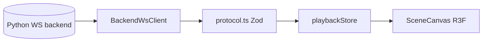

# Architecture

## Layers

```
src/
  app/           AppShell (frame: left pane and the shown section), WorkbenchSection
                 (the workbench views and their state), UI-only Zustand (uiStore)
  components/    Shared UI pieces (SectionFrame, SectionPlaceholder, LoadingSpinner)
  domain/        Simulation protocol, WebSocket client, playback store; cluster/ has the
                 cluster list, the operator API client, the live channel client and stores
  features/      React UI by section: workbench/ (connection, controls, metrics, monitor,
                 scene), cluster/, campaigns/, observe/, results/
  language/      Lezer grammar for .problem files
```

## Sections

The left pane has five sections: Workbench (with the views Domain Configuration, Scene
Generation, Trajectory Generation, Simulation and Connections), Cluster, Campaigns, Observe
and Results. `uiStore` keeps `section` and `workbenchView` (persisted, v4). The workbench
stays mounted while another section is shown, so its gateway socket and state carry on.

The cluster sections work on the cluster selected in the left pane. `domain/cluster/clusterStore.ts`
keeps the list (name and operator URL, per browser). A master's operator API listens on its
127.0.0.1:5174; from another machine it is reached over `ssh -L 5174:127.0.0.1:5174 <user>@<master>`.

- `operatorApi.ts`: fetch client of the operator routes, answers checked by the Zod schemas
  in `schemas.ts`, errors as `OperatorApiError` with the server's reasons, `X-Total-Count`.
- `liveChannel.ts`: one WebSocket per cluster to `/cluster/live` (contract in `liveProtocol.ts`):
  reference-counted topic subscriptions, snapshot then updates with per-topic `seq`, reconnect
  with backoff and resubscribe, ping. `liveTopics.ts` has the reducers per topic.
- `useLiveTopic(topic, reducer)`: a topic of the selected cluster as React state.
- `nodesStore.ts`: the nodes of the selected cluster from the `nodes` topic, with a REST poll
  while the topic is not live.

## Data flow



## WebSocket lifecycle

1. **Connect**: `BackendWsClient` to `VITE_WS_URL`
2. **Generate scene**: `generate_scene` with functional spec + domain YAML -> `generated_scene`
3. **Load scenario**: `load_scenario_file` -> `preview_trajectory_chunk`(s)
   A bare scene loads as its initial scene only (`initial_state` with trajectory length 0); trajectories come from the trajectory generator (`generate_trajectories` with `generator` monitor_driven_rrt or straight), and the simulation workflow refuses to initialize without them.
4. **Initialize simulation**: `initialize_simulation` -> `initial_state`
5. **Run**: `start_simulation` -> `simulation_trajectory_chunk`(s) and live `frame` pushes

Preview and simulation trajectories are stored separately in `playbackStore` for side-by-side analysis.

## Performance

Large trajectory chunks may be merged in a **Web Worker** (`mergeFrames.worker.ts`) before updating the store. Playback uses **requestAnimationFrame** for smooth time advancement.
